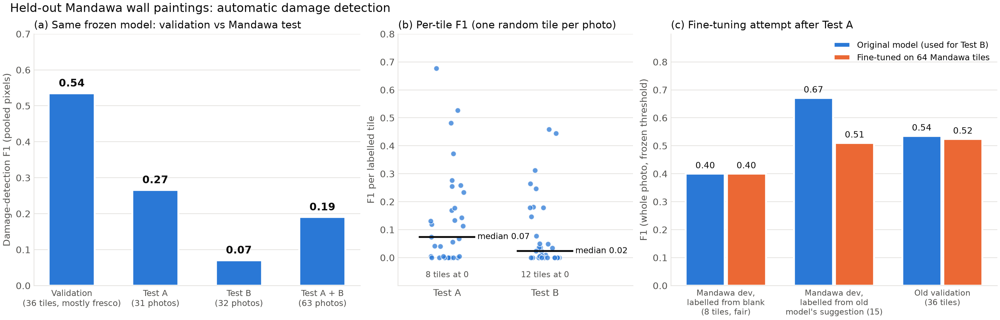
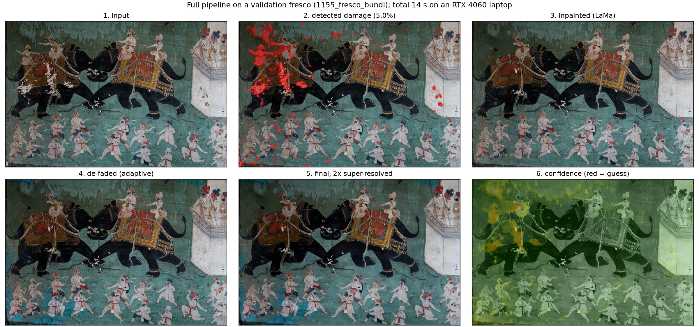
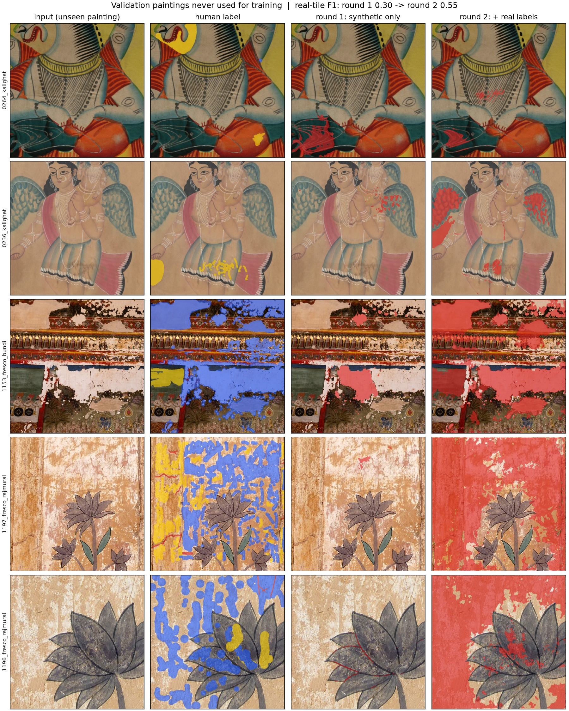
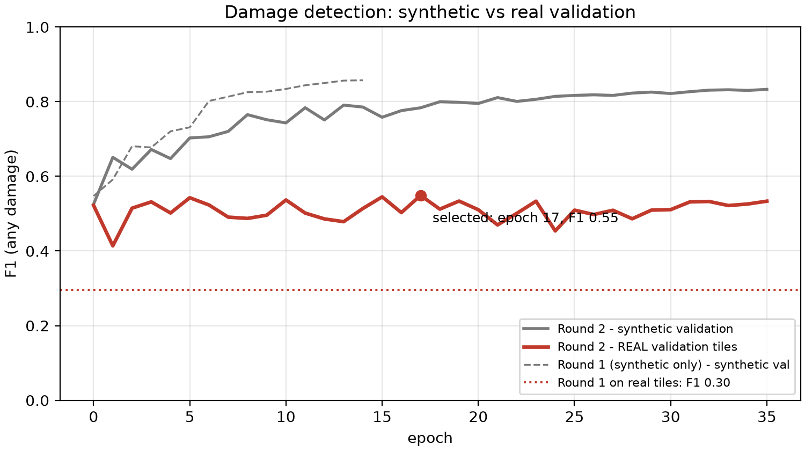

# Digital Restoration of Indian Folk Paintings

A four-stage pipeline that turns a photo or scan of a damaged Indian folk painting or wall painting (Madhubani, Kalighat, Pattachitra, Kalamkari, Rajasthani frescoes) into a restored, high-resolution image. Alongside the image it saves a per-pixel confidence map that shows how much of each repaired area the model had to guess.

CS F407 course project. The pipeline is fully automatic at inference time: no manual masks are needed for a new painting. An optional semi-automatic mode (`--review-mask`) lets a person correct the detected damage before it is repaired.

```
damaged painting
  └─ M1  CLAHE (LAB) + U-Net (pretrained ResNet34)  →  damage mask  [crack | loss | stain]
  └─ M2  LaMa (Fourier convolutions) inpainting, applied inside the mask only
  └─ M3  colour de-fading: Pix2Pix (residual U-Net + PatchGAN), limited by how faded the input is
          (or reference LAB transfer)
  └─ M4  Real-ESRGAN x4 tiled super-resolution  +  spatial confidence map
```

## Results

### Held-out test: 63 Mandawa wall-painting photos (never used for training or tuning)

Automatic damage detection, frozen model (`seg_best.pt`, md5 `a11c3b0772e5`) and threshold 0.5, scored once per half:

| | Test A (31 photos) | Test B (32 photos) | A + B (63) |
|---|---|---|---|
| F1 (pooled over pixels) | 0.27 | 0.07 | **0.19** |
| Precision / recall | 0.39 / 0.20 | 0.14 / 0.05 | |
| Mean per-tile F1 | 0.14 | 0.09 | |

- Answer key: one random 512-px tile per photo, labelled from a blank start by 4 annotators; agreement on 3 shared tiles was mean IoU 0.45, which caps what any model can score.
- The model finds clear cracks and chips on plain plaster, but misses small, scattered wear and flaking and the diffuse abrasion of ornamental panels. One panel (photos `19mar16`, `19mar20_*`) holds 39 % of Test B's labelled damage and is almost entirely missed; without it B is 0.10. It also over-flags worn floors and painted dot patterns.



*Figure 7 (`python scripts/make_test_figure.py`). (a) Validation is re-scored here exactly like the test (whole tile through the pipeline), giving 0.54 instead of the 0.55 measured during training. (b) Each dot is one labelled tile. (c) Only the blank-start tiles are a fair comparison; see the round-3 note below.*

- Conclusion: a large **domain gap** between the training data (mostly paper and cloth) and lime-plaster walls (0.55 on in-domain validation vs 0.19 on Mandawa).

**Attempted improvement (round 3, after Test A, before Test B).** Test A became a development set: its photos were split by panel into training (23 photos) and development (8 photos), 56 more tiles were labelled, and the model was fine-tuned on 64 Mandawa tiles (`--extra-real`, `--pos-boost 2`). On development tiles labelled from a blank start it tied with the original model (F1 0.40 vs 0.40), and on the old validation set it was slightly worse (0.52 vs 0.54), so the **original model was kept** for Test B. The new tiles had been labelled by correcting the model's suggested masks; on those tiles the original model scored 0.67 against 0.40 on blank-start tiles, showing that suggestion-started labels are anchored to the model that made them. They should not be used to compare models, and they probably limited what fine-tuning could learn. Checkpoints are kept in `checkpoints/round3/`; comparison: `scripts/compare_models.py`.

### Validation (in-domain)

| | Value |
|---|---|
| Damage detection, F1 on 36 real validation tiles (27 paintings never used for training) | **0.55** (IoU 0.38), threshold 0.5 |
| Same tiles, round-1 model trained on synthetic damage only | 0.30 (IoU 0.17), even with its threshold re-tuned on these tiles |
| Agreement between our 4 annotators (calibration tiles, 36 pairs) | mean IoU 0.38 (0.45 on the Mandawa test tiles) |
| Colour de-fading, PSNR on synthetically faded validation tiles | 23.0 dB vs 19.2 dB for the faded input |
| Full pipeline, one 2048-px painting, RTX 4060 laptop | 8-18 s |

Figures are in [`docs/figures/`](docs/figures/) (sources and licences in [`SOURCES.md`](docs/figures/SOURCES.md); exact numbers in `numbers.json`). To regenerate them, run `python scripts/make_report_figures.py`.





Known weaknesses (validation and test): it misses small scattered damage and diffuse abrasion on plaster; on worn plaster walls the detector marks large areas of abraded background as damage; some dense painted textures (e.g. feather patterns) are flagged; Pix2Pix can leave local colour patches in dark areas.

## Why the previous version failed on real paintings, and what changed

| Problem | Fix in this version |
|---|---|
| Synthetic cracks (smooth Bézier strokes) looked nothing like real ones, so the model learned to detect the synthetic strokes rather than damage | `synth_damage.py`: polygonal **craquelure** networks, branching cracks of varying width, dark or light cracks with raised edges, flakes that show the paper/cloth ground (clustered along cracks), water stains with tide-lines, foxing, mold |
| Clean training tiles did not look like real scans | The damage is followed by scan degradation (uneven lighting, blur, noise, JPEG, resampling) |
| Painted linework looks like cracks | 25% of training tiles are undamaged, with empty masks, so the model learns that linework is not damage |
| Only synthetic data was used | **Hand-labelled real tiles** are mixed into training (30% of samples), and real damage is cut out and pasted onto clean tiles (`damage_bank`) |
| Model chosen by its score on synthetic validation | The best checkpoint and the threshold are chosen by **F1 on real labelled tiles** |
| U-Net trained from scratch on fewer than 50 images | ImageNet-pretrained encoder plus scSE attention |
| BCE loss gives up and predicts no damage when damage covers few pixels | Dice + Focal loss; the threshold is tuned rather than fixed at 0.5 |
| Different scale or preprocessing at test time | One `seg_preprocess` function is shared by training and inference; training uses random scales (0.5–1.5×); inference runs tiled at the working resolution |

## Setup

```bash
# environment (already created at D:\AI_Project\env)
conda create -p ./env python=3.11 -y
env\python -m pip install torch torchvision --index-url https://download.pytorch.org/whl/cu124
env\python -m pip install -r requirements.txt
env\python scripts/download_weights.py        # big-lama.pt + RealESRGAN_x4plus.pth
```

All commands below assume `env\python` (or activate the env: `conda activate D:\AI_Project\env`).
For the notebook, choose the **"AI Restoration (py3.11)"** kernel. It is already registered.

Note: some networks block GitHub's release-asset server, so `download_weights.py` falls back to Hugging Face mirrors.

**Not in this repository** (see `.gitignore`): `data/` (datasets and the professor's test photos), `weights/`, `checkpoints/` and `outputs/`. Pretrained LaMa / Real-ESRGAN weights come from `download_weights.py`. Our trained models (`checkpoints/seg_best.pt`, `checkpoints/color_best.pt`) are shared separately; put them in `checkpoints/` or retrain with the workflow below.

**Smoke test without real data:** `python scripts/make_demo_data.py` creates procedural folk-art-style images in `data/demo/`. Use them only to check that the scripts run, never as training data for the real model.

## Data layout

```
data/clean/                  undamaged or well-preserved paintings, or clean crops of damaged ones
data/damaged/                REAL damaged paintings you want to restore
data/real_labeled/images/    real damaged tiles (created by make_label_tiles.py)
data/real_labeled/masks/     your corrected masks: 0 bg, 1 crack, 2 loss, 3 stain, 255 damage of unknown type
data/damage_bank/            real damage cut-outs (created by build_damage_bank.py)
```

If you have very few clean paintings, crop the undamaged areas out of damaged ones and put the crops in `data/clean/`. Public-domain folk paintings, for example from Wikimedia Commons, also work.

### Current dataset: Kaggle "Indian paintings" (MIT, 8 styles)
```bash
python scripts/import_dataset.py path/to/kaggle/archive                   # -> data/pool (862 after removing duplicates and images <400px)
python scripts/split_pool.py                                            # -> data/clean (806), data/damaged (21)
```
- `data/pool/damaged_ids.txt` lists 21 paintings with real visible damage (flaking, abrasion, stains, losses), checked on 1:1 crops.
- `data/pool/exclude_ids.txt` lists aged works whose damage is unclear, plus photos that aren't paintings. They are kept out of `clean`, because any unlabelled damage in the clean pool would teach the model that damage is normal.
- Edit the id lists (ids are shown in `outputs/contact_sheets/`) and rerun `split_pool.py`.
- The real damage is mostly flaking, stains and abrasion rather than fine craquelure, because web JPEGs blur fine cracks.

### Pattachitra and Kalamkari: Hugging Face "Indian Art Styles" (CC BY 4.0), Wikimedia subset only
Source: https://huggingface.co/datasets/Divya0001/indian-art-styles (citation in its card: Pattanayak, 2026). Its labels are **unreliable**:
- The V&A part (85% of both classes) consists of unrelated photographs and drawings, and the same images appear under both labels.
- The Met part consists of Chinese paintings.
- Only the Wikimedia part is usable, and those images were downscaled to 512 px. About half are documentary photos of artists and markets.
```bash
# downloads data/external/hf_wikimedia/{pattachitra,kalamkari} (see data/external/wikimedia_subset.csv)
python scripts/import_dataset.py data/external/hf_wikimedia --append --prefix hf_   # ids 862..1131
python scripts/split_pool.py
```
After hand curation (contact sheets in `outputs/contact_sheets_hf/`), this added 106 clean paintings and 4 damaged ones.

### Frescoes / wall paintings: Wikimedia Commons (CC0 / PD / CC BY / CC BY-SA)
Because the final test set is Mandawa wall paintings, we added frescoes from other places, **excluding anything from Mandawa**:
```bash
python scripts/collect_commons.py --max-per-seed 120   # Shekhawati towns (not Mandawa), Bundi, Rajasthan murals, Sikh havelis, Ajanta
```
- Every file is listed with licence, author and source URL in `data/external/commons_frescoes/attribution.csv`.
- Hand-curated decisions per title are in `data/external/commons_frescoes_curation.csv` (photos of streets/buildings and recoloured duplicates excluded).
- Imported as pool ids 1132-1222: 67 damaged frescoes (labelled, batch 2) and 24 clean ones.

**Current totals: 936 clean / 91 real-damaged paintings, 132 hand-labelled tiles.**

## Workflow

```bash
# 0. Check that synthetic damage looks like your real damage
python scripts/preview_synth.py                     # -> outputs/synth_preview.png

# 1. First model, trained on synthetic data only
python scripts/train_seg.py --epochs 15

# 2. Label real tiles (the most effective single step; 20-40 tiles is enough to begin)
python scripts/make_label_tiles.py --per-image 6    # suggested masks come from the model
python scripts/label_tool.py                        # correct them with the brush, then press s
python scripts/build_damage_bank.py                 # real damage cut-outs for copy-paste

# 3. Retrain with the real labels (selection by real F1)
python scripts/train_seg.py --epochs 40
#    Repeat steps 2-3 once or twice. Each pass, label the tiles where the model is wrong.

# 4. Colour model
python scripts/train_color.py --epochs 30

# 5. Restore
python scripts/restore.py data/damaged --sr-scale 2
python scripts/restore.py painting.jpg --color-ref protected_margin.png   # reference-based colour
python scripts/restore.py painting.jpg --review-mask                       # correct the mask by hand first
```

**Running it on your own images** (Windows, from the project folder):
```powershell
.\env\python.exe scripts\restore.py "C:\path\to\painting.jpg"              # one image
.\env\python.exe scripts\restore.py "C:\path\to\folder" --out "D:\results"  # every image in a folder
```
Useful options: `--threshold 0.4` (detect more; 0.6 = less), `--no-color`, `--color-strength 0.5`, `--classes crack,loss`, `--sr-scale 1` (no upscaling), `--no-uncertainty` (faster).

**Damage types.** `01_mask_overlay.png` is coloured by the most likely type (red crack, blue loss, yellow stain) with a legend; `01_mask_types.png` stores the type per pixel and `report.json` the % per type. The type is less reliable than the damage / no-damage decision (cracks are sometimes coloured as stains).

**Semi-automatic mode (`--review-mask`).** After detection, the mask opens in the brush editor of the label tool (left-drag paint with 1 crack / 2 loss / 3 stain / 4 unknown, right-drag erase, wheel zoom, `r` back to the model's mask, `s` accept, `q` keep the model's mask). Inpainting, colour and upscaling then use the corrected mask. The model's mask (`01_mask_types_model.png`), the corrected one (`review/masks/`) and `"mask_edited_by_user"` in `report.json` are kept, so corrected results are never mistaken for automatic ones. All test scores above are fully automatic.

The colour stage measures how faded the input is (90th-percentile chroma and lightness range, compared with the clean training set) and limits the de-fading accordingly: a vivid painting is barely changed, a faded one may gain up to +40 % chroma, and global colour casts are capped. `report.json` records the fade score; `--no-adaptive-color` disables the limit.

Each restored painting gets a folder in `outputs/restored/<name>/` containing the mask and overlay, the inpainted image, the colour-corrected image, the final super-resolved image, `confidence.npy` and `confidence_map.png` (green = original or reliable, red = guessed infill), and `report.json`.

## Labelling as a team

Labelling is split across annotators with self-contained kits (label tool + guide + launchers, only Python needed):
```bash
python scripts/make_label_tiles.py --src <folder of damaged paintings> --per-image 1
python scripts/make_label_kits.py --people "Atharva,Rudranil,Soumya,Vidwath" --calib 2
#   -> outputs/label_kits/<name>_batchN.zip ; tiles split by painting, plus shared calibration tiles
python scripts/merge_labels.py outputs/label_returns/       # merges returns, pairwise IoU + majority-vote consensus
python scripts/build_damage_bank.py                          # uses training paintings only (no validation leakage)
```
Rules for annotators are in `docs/LABELING_GUIDE.md`. Validation paintings are chosen by a stable hash of the painting name (`split_paths`), so tiles of one painting never straddle train/validation.

## Held-out test set (the professor's Mandawa paintings)

The data is split into three sets:

| Split | Data | Used for |
|---|---|---|
| train | `data/clean` (synthetic damage) + labelled tiles from `data/damaged` + `damage_bank` | fitting weights |
| validation | 30% of the labelled real tiles from `data/damaged` | choosing the checkpoint and threshold |
| **test** | `data/test_holdout/` (Mandawa) | **final evaluation only, run once** |

- No training or labelling script reads `data/test_holdout`. Do not copy these images anywhere else, not even into `damage_bank`.
- **Two-stage protocol.** `scripts/make_test_tiles.py` splits the 63 test photos into **Test A (31) / Test B (32)**, keeping photos of the same panel together and balancing style series, and saves the split in `data/test_holdout/split.csv` before any result is seen. One **random** tile per photo is labelled from a blank start (no model suggestion) as the answer key.
  1. Score the current model **once on A**: `python scripts/evaluate_test.py --split A`
  2. If it is satisfactory, score the same model on B (`--split B`) and report all 63.
  3. If the model is changed after seeing A, score the changed model **once on B**; that is its unbiased number, and A becomes a development set.
- `evaluate_test.py` runs the model on the whole photo and only then compares the labelled tile with the answer key; the checkpoint and threshold are frozen. It refuses to re-score a split without `--force`, and logs every run (time, split, checkpoint hash) to `outputs/test_runs_log.csv`.
- It first checks for leaks (the same image, even re-encoded, appearing in any training folder).
- **What happened:** A was scored once (F1 0.27); the model was then changed (round 3) but did not beat the original on blank-labelled development tiles, so the **original** model was scored once on B (F1 0.07). Both runs are in `outputs/test_runs_log.csv`. B is now used up: later changes cannot get a new unbiased Mandawa score.
- Round-3 tools: `make_mandawa_dev_tiles.py` (extra tiles from Test A photos only, split by panel into train/dev, saved once in `data/mandawa_A_label/roles.csv`), `prepare_mandawa_round.py`, `train_seg.py --init --extra-real --dev --pos-boost --low-mem`, `compare_models.py`.
- **Personal hold-out:** 4 further Mandawa photos in `data/personal_holdout/` are excluded from everything, for qualitative testing only.
- Expect a domain gap: Mandawa paintings are on lime plaster, while most training data is paper and cloth (frescoes are about 10 %). Report the result honestly.

## Validation notebook

`notebooks/validation.ipynb` contains:
- training loss and F1 curves for segmentation and colour
- how many patches each painting yields
- a comparison of the classical detector and the U-Net on real labelled tiles
- per-class metrics

## How the confidence map is computed (M4)

The confidence of each pixel combines three signals:
1. **Disagreement between LaMa runs.** The image is inpainted again with the input flipped and with the mask enlarged by 4 px and 8 px. Wherever these versions differ, the model is guessing.
2. **Distance from real paint.** The deeper a pixel is inside a missing area, the less evidence it has.
3. **Detection ambiguity.** This is high when the segmentation probability is close to the threshold, or when the test-time-augmented predictions disagree.

The PatchGAN discriminator saved with the colour model (`checkpoints/color_disc_best.pt`) can serve as an additional per-patch realism score.

## Memory (RTX 4060, 8 GB)

- Segmentation training: batch 8 at 384 px with AMP. Lower `--batch` if you run out of memory.
- Inference: every stage runs on overlapping tiles and blends them with a cosine window, so any image size fits and there are no seams. LaMa only processes windows that contain damage.
- Real-ESRGAN runs in fp16 on 256 px tiles.

## Extensions
- **CycleGAN (unpaired)** for de-fading: map truly faded areas to the un-faded margins. It would sit next to `color.py`, reusing `PatchDiscriminator`.
- **Fine-tuning LaMa** on folk-art tiles with synthetic masks.
- **Per-class inpainting:** inpaint cracks and losses only, and fix stains with the colour stage (`--classes crack,loss`).
